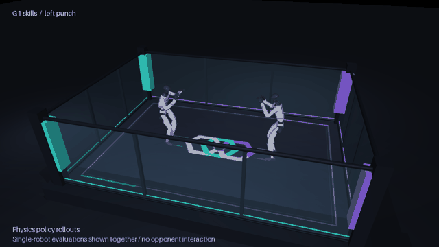

# Robot fights RL lab

[](docs/assets/g1-skills.mp4)

[Watch the skills video](docs/assets/g1-skills.mp4) · [Training and results](docs/g1_skills.md) · [Technical guide](docs/README.md)

A development workspace for a humanoid fighting league using Unitree G1. The preview shows a learned motion tracker performing left and right punches and a front kick. These are recorded single-robot physics evaluations, displayed together in the rectangular RSL arena. Opponent interaction and contact training are the next stages.

```bash
uv sync --project simulation --locked
uv run --project simulation python simulation/skills.py
```

The Python script opens the mjswan viewer with a skill selector, playback and camera controls. The recorded rollouts are included, so this preview needs no training GPU. [Train and evaluate the controller](docs/g1_skills.md) or inspect the [original kinematic arena demo](docs/simulation.md).

League documentation is in [`docs/`](docs/README.md). Editable source projects are in [`external/`](docs/repositories.md). [Media sources](docs/assets/README.md).
