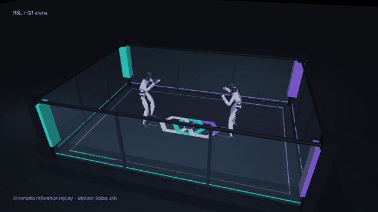

# Demonstrations

[Main guide](README.md)

These examples make different parts of the development path visible. The first is the local arena demo; the others belong to their linked projects.

## Local G1 arena

[Watch the video](assets/g1-arena.mp4) or [run the Python and mjswan demo](simulation.md). This is kinematic reference playback, with stock G1 models and a rectangular enclosure. It demonstrates scene composition and motion inspection before a learned controller and contact training are connected.

## Physical robot fights

**[Watch REK0](https://www.youtube.com/watch?v=PR7yNhfHAKg).** Event recording from REK, also embedded in the [Reflex Arc engineering account](https://reflexarc.co.uk/projects/rek-robots). Watch how pilots manage spacing, how contact interrupts motion, and what happens between exchanges. The footage does not identify a reproducible controller-training configuration.

[Unitree's G1 boxing page](https://www.unitree.com/boxing/) provides another manufacturer demonstration of strikes, balance and recovery. It is useful visual context; the page does not supply an open training pipeline for those behaviors.

## A punch before contact training

The Robo Jab team's GIF connects a source video, human motion recovery, retargeting and simulated execution. Its [repository](https://github.com/abtonmoy/ai_hackathon_calhacks) is a concrete example of the motion-data pipeline. This is a single-robot jab demonstration, not a two-robot fight or evidence of contact robustness.

## Simulated fighting

**[Watch REK simulator gameplay](https://reflexarc.co.uk/img/work/rek/rek-sim-gameplay.mp4).** Video published by Reflex Arc, credited to REK. This illustrates the target pilot experience and the need for shared physics and match state. It is a different kind of evidence from physical robot footage.

## Motion tracking research

[Try the SuperMimic browser demo](https://supermimic.github.io/demo/) to inspect its motion tracker, then see the hardware demonstrations on the [project page](https://supermimic.github.io/#robot). Use these to understand motion execution. Contact skills against another robot would require additional training and evaluation.

The animated jab images are embedded from their authors' repository. The fight videos use clickable previews so they remain usable in a GitHub README. [Media sources and attribution](assets/README.md)

## Game motion references

The main guide includes a [Mortal Kombat gameplay GIF](README.md#build-a-motion-library-around-usable-skills) as a source of candidate fight skills. Game animations need retargeting and dynamic checks before they can enter the G1 motion library. See the [feasibility filter](motions.md#game-footage-as-a-skill-source) for joint, contact, balance and motor torque and speed limits.
