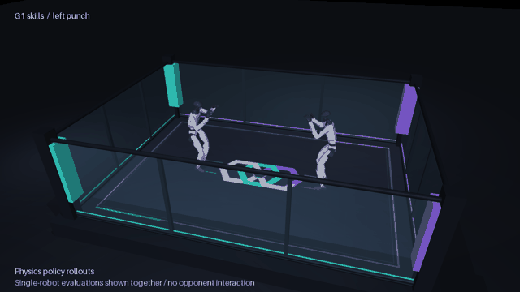

# G1 motion skills

[Main guide](README.md) · [Arena](simulation.md) · [Training approach](training.md)

The first local experiment learns a left punch, a right punch and a right front kick with one reference-conditioned policy. Each motion starts in the same nominal stance and ends with a recovery hold. The policy must move the whole robot through the sequence under gravity and contact constraints. Its pelvis is free; there is no support harness or root pose override during training.

This is a small tracking experiment built on the included Unitree mjlab code. It establishes the transition from a visual reference to a learned controller. Contact with an opponent, target selection, fall recovery and SONIC adaptation remain separate experiments.

## Current result

[](assets/g1-skills.mp4)

The selected checkpoint completes all three moves from nominal posture. In two sets of 64 trials per skill, it also completed every sequence with an initial velocity perturbation and another impulse 2.4 seconds into the movement. Each linear and angular velocity component was sampled within ±0.15 m/s or ±0.15 rad/s. Training used seed 42; evaluation used seeds 314 and 2718. These results describe this narrow simulation test, rather than general robustness.

| Skill | Clean joint RMSE | Clean final root displacement | Disturbed completions, seed 2718 |
| --- | --- | --- | --- |
| Left punch | 0.119 rad | 2.4 cm | 64 / 64 |
| Right punch | 0.118 rad | 3.0 cm | 64 / 64 |
| Right front kick | 0.095 rad | 7.3 cm | 64 / 64 |

The clean kick raises its ankle to approximately 86 cm. The disturbed trials sometimes need a larger recovery step: the first recorded kick in the second seed ends about 30 cm from its starting position. Completion means the tracking termination checks did not fire; it does not require returning to exactly the same footprint. No motor sample reached 95% of its modeled effort limit in the clean recordings. A small fraction did during disturbed kick trials. The model does not establish a hardware torque-speed or thermal envelope.

The full 1,500-iteration training loop took about 18 minutes on one RTX PRO 6000 Blackwell, excluding installation, initialization, evaluation and rendering. Checkpoint 1200 was selected for the demo after comparing full-sequence tracking and recovery. At checkpoint 200 no move completed; at 900 all three completed once, but the left punch drifted and often failed the perturbation test. Continuing training improved that behavior. [Recorded metrics, hashes and configuration](results/g1-skills.json)

The small recorded rollout files are included. To inspect them without training:

```bash
uv sync --project simulation --locked
uv run --project simulation python simulation/skills.py
```

This opens the mjswan page at `http://localhost:18766`. Use `--port` to choose another port or `--build-only` to build the page without serving it. The training checkpoints and ONNX actor are retained locally under `training/output/`; they are not bundled with the browser recording.

## Motion sources

| Skill | Starting data | Preparation |
| --- | --- | --- |
| Right punch | Robo Jab's video-derived `IMG_3430.csv`, frames 125 through 219 | Constant heading alignment, resampling from 30 to 50 Hz, nominal entry and recovery |
| Left punch | The same right punch | Sagittal reflection of the root and corresponding left/right joints, checked with forward kinematics |
| Right front kick | SONIC's bundled `neutral_kick_R_001__A543` reference | Isaac Lab joint order converted to MuJoCo order; root quaternion remains wxyz; original 50 Hz timing |

The [Robo Jab source](https://github.com/abtonmoy/ai_hackathon_calhacks/tree/bd8a0a65c60787296c7eb9a90be10b17fae3e12b) uses video reconstruction and retargeting. This experiment starts from its retargeted output; it does not rerun GVHMR or reconstruct a new video. The downloader checks the original Git blob hash and keeps the raw recording in an ignored local cache. That source revision has no top-level license; its data is not newly vendored here.

The kick is already present in the imported [SONIC example data](../external/GR00T-WholeBodyControl/gear_sonic_deploy/reference/example/neutral_kick_R_001__A543), from [upstream commit 1e1ec4f](https://github.com/NVlabs/GR00T-WholeBodyControl/commit/1e1ec4f5f27e6c3e03048f693bd7c60cce04afda). Its joint mapping and 50 Hz timebase are taken from SONIC's deployment reader. See the preserved [upstream license](../external/GR00T-WholeBodyControl/LICENSE).

The converter grounds the lowest foot contact geometry and generates body targets from the exact training model. It checks joint position bounds and records joint speeds. These are kinematic checks. They do not prove torque feasibility or balance. The kick requires roughly 19.5 rad/s at the fastest joint in the prepared reference, which makes actuator effort and recovery measurements particularly relevant.

## Run locally

Use a separate environment from the arena renderer. Unitree's imported trainer pins mjlab 1.2.0 and MuJoCo Warp 3.5.0. The local lock also pins MuJoCo 3.5.0 and Warp 1.12.0: newer releases caused concrete API errors with that trainer.

```bash
uv sync --project training --locked
uv run --project training python training/prepare.py
uv run --project training python training/test_references.py
uv run --project training python training/train.py \
  --output training/output/foundation \
  --num-envs 2048 --iterations 1500
```

Preparation runs on the CPU. Training and evaluation require a compatible NVIDIA GPU. The first download retrieves the pinned jab CSV; no W&B account is required. Prepared references live in `training/data`, and checkpoints, TensorBoard logs and resolved configurations live in the selected output directory. Both are ignored by Git. Choose a new output directory for every experiment.

The actor receives reference joint positions and velocities, relative reference torso orientation, angular velocity, joint positions, joint velocities and its previous action. It has no privileged root position or measured linear velocity input. The critic receives additional simulation state. This is a proprioceptive tracking controller with a motion command, rather than an autonomous fighting agent.

PPO learns joint position targets through the training model's gains, action scales and effort limits. Control runs at 50 Hz with four physics steps per action. The foundation stage disables external pushes and model randomization while learning the basic sequence; observation noise remains enabled. `--stage robust` restores Unitree's friction, encoder, center-of-mass and push randomization. That option is a further experiment, not evidence that a checkpoint is robust.

To continue a checkpoint while preserving the original run:

```bash
uv run --project training python training/train.py \
  --resume training/output/foundation/model_1499.pt \
  --output training/output/robust --stage robust \
  --num-envs 2048 --iterations 1000
```

`--iterations` is the number of additional PPO iterations for that invocation. Checkpoints are saved every 100 iterations and at completion. The finished run also exports an ONNX actor. That actor still needs the matching observation, action and reference pipeline; it is not a drop-in SONIC checkpoint.

## Evaluate before choosing a checkpoint

```bash
uv run --project training python training/evaluate.py \
  training/output/foundation/model_1499.pt \
  --output training/output/eval-clean --num-envs 1

uv run --project training python training/evaluate.py \
  training/output/foundation/model_1499.pt \
  --output training/output/eval-perturbed --num-envs 64 --perturb
```

Every execution starts at the beginning of a skill, including the nominal hold, entry, strike and recovery. Evaluation stops before the upstream motion command's automatic end-of-clip state reset. The first termination marks a trial as failed permanently. The recorded trajectory stops at that failure instead of joining together retries.

The report includes completion counts, first failure frames, joint tracking error, body position error, minimum root height and the fraction of motor samples at 95% of the modeled effort limit. Error summaries cover the surviving portion of a rollout and must be read together with completion. A short failed attempt can have a small average error.

Evaluation also exports the exact checkpoint's ONNX actor, checks the graph and compares its normalized output with PyTorch. Add `--push-at 2.4 --seed 2718` to the perturbed command to reproduce the second evaluation condition above. To evaluate the selected local checkpoint, use `training/output/foundation-v1/model_1200.pt`.

The perturbed evaluation adds independently sampled initial root linear and angular velocities, each component within ±0.15 m/s or ±0.15 rad/s. This is a narrow balance test. It does not test blocked punches, sustained contact, hardware latency, actuator temperature or deployment on a physical G1.

## Inspect the moves

Use the arena environment to render references:

```bash
uv sync --project simulation --locked
MUJOCO_GL=egl uv run --project simulation python simulation/skills.py \
  --source training/data --kind reference \
  --render simulation/output/skill-references.mp4
```

For a successful policy evaluation, replace the source and label:

```bash
MUJOCO_GL=egl uv run --project simulation python simulation/skills.py \
  --source training/output/eval-clean --kind policy \
  --render simulation/output/skill-policy.mp4 \
  --web simulation/output/skills-web

uv run --project simulation python simulation/demo.py \
  --serve-existing --output simulation/output/skills-web --port 18766
```

The renderer rejects failed or unlabelled trajectories in policy mode. It shows two copies of each single-robot evaluation facing each other in the arena. These robots were simulated separately. The mjswan page plays their recorded states and offers a skill selector; it does not run live inference or simulate an opponent interaction. Each skill is a separate evaluation episode, with a reset between episodes.

The next contact experiment should add a padded target, then vary target location and compliance, and include missed and blocked attempts. Measure whether the robot can complete a strike and return to a controllable stance after each disturbance. A visually plausible reference and a successful air strike are useful milestones on that path.
