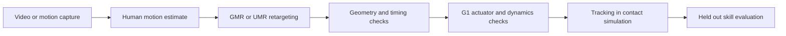

# Motion preparation

[Main guide](README.md)

## Start with usable data

Existing robot references and recorded teleoperation are usually easier to validate than arbitrary video. [BONES SEED](https://huggingface.co/datasets/bones-studio/seed) is a starting collection; check the dataset and body model terms for the intended use. Record the source clip, robot model, sampling rate and processing settings with each motion.

## Recover motion from video

[GVHMR](../external/GVHMR) estimates world grounded human motion from monocular video. Its output is a body motion estimate, not robot joint targets. [GMR](https://github.com/YanjieZe/GMR) includes a GVHMR conversion path and maps human motion onto supported humanoid models.

[FlowHMR](../external/flowhmr) is a newer candidate worth evaluating for this pipeline. It uses physics tracking rewards during training; its [project demonstrations](https://flowhmr.github.io/) also show GMR retargeting followed by SONIC tracking on a simulated G1. This is useful evidence for integration, but each proposed fighting skill still needs its own feasibility and contact tests. Both FlowHMR and GVHMR are included as editable source; see [setup, dependencies and licences](repositories.md#video-motion-recovery). [OnlineHMR](https://tsukasane.github.io/Video-OnlineHMR/) remains an external option for causal, streaming reconstruction.

[UMR](../external/UMR) is the point cloud based alternative. It learns surface correspondences and uses them in constrained retargeting. It is useful when morphology and interaction contacts matter beyond sparse joint matching. Its correspondence stage is reused for the same source template and robot. See the [included source and setup](repositories.md#retargeting-and-motion-learning).

These stages have different jobs. Retargeting finds compatible poses; simulation training learns how to execute them under dynamics. Neither reconstruction nor retargeting establishes real contact forces.

## Game footage as a skill source

Mortal Kombat and other fighting games can suggest guards, steps, punches, kicks and transitions. Use gameplay clips to propose candidate skills and inspect their timing. The [example in the main guide](README.md#build-a-motion-library-around-usable-skills) illustrates this source of ideas. A GIF is useful for discussion; reconstruction needs footage with known timing, sufficient resolution and a visible performer. Stylized characters, camera cuts and occlusion can make human motion estimators fail.

Filter candidates against the actual G1 configuration before spending a full training run on them:

| Check | Acceptance evidence |
| --- | --- |
| Reach and geometry | Joint ranges, self collision, ground clearance and target reach remain valid through entry, execution and recovery. |
| Motor capability | Required joint torque and velocity fit the configured motor torque versus speed envelope, with margin. Check permitted peak duration, continuous load and thermal limits across repeated executions. |
| Dynamic execution | A controller tracks the reference with realistic actuator limits, gravity, friction and contacts, and returns to a controllable state. Log requested and applied torque, saturation duration, tracking error and falls. |
| Contact robustness | The skill remains acceptable when the target shifts, blocks the strike or is missed, across the chosen variations in mass, friction and delay. |

Inverse dynamics can provide an initial torque estimate when contact assumptions are defined. Closed loop simulation is still needed: kinematically playing an animation or clipping excessive torque does not establish that the robot can execute it. Reject infeasible clips, or change their reach, height and timing and repeat the checks. Slower playback may reduce inertial demand, but does not remove gravity loads and can invalidate jumps or balance transitions. Use the limits of the particular G1 variant and configured operating envelope, rather than a single advertised peak torque.

Record the rejection reason or the tested operating range with each candidate. Only references that pass these checks enter the proposed skill library; simulated success still precedes gradual hardware qualification.

The included [G1 actuator configuration](../external/unitree_rl_mjlab/src/assets/robots/unitree_g1/g1_constants.py) is a starting point for inspecting effort and velocity values. Confirm what the simulator actually enforces; these constants alone do not implement a full motor thermal model or establish hardware limits for every G1 variant.

## Prepare a skill

1. Inspect reconstruction for occlusion errors, foot sliding, root drift and incorrect scale.
2. Check joint limits, self collision, floor penetration and reachable target placement.
3. Preserve timestamps and derive velocities consistently after resampling or retiming.
4. Include the approach, execution and return to stance, rather than extracting only the striking frame.
5. Represent the target or opponent in simulation. Label intended contact surfaces and timing; do not infer force from pixels.
6. Test the reference dynamically before adding it to the training set.

For mjlab, use its [motion preprocessing workflow](https://mujocolab.github.io/mjlab/v1.6.0/source/training/motion_imitation.html). For SONIC, use its own [training data workflow](https://nvlabs.github.io/GR00T-WholeBodyControl/user_guide/training.html). A shared file extension does not imply matching coordinates, joints or body indices.

Keep entire source clips or recording sessions in a single data split. Adjacent frames from one demonstration should not appear in both training and validation. Include failed contact and recovery trials in the evaluation report, not just successful tracking error.

## Follow an existing example

The [Robo Jab repository](https://github.com/abtonmoy/ai_hackathon_calhacks) connects phone video, GVHMR, GMR and a G1 tracking trainer. Its [animated pipeline](demonstrations.md#a-punch-before-contact-training) makes the intermediate artifacts visible. Read its [capture guide](https://github.com/abtonmoy/ai_hackathon_calhacks/blob/main/CAPTURE_GUIDE.md), [motion data format](https://github.com/abtonmoy/ai_hackathon_calhacks/blob/main/data/README.md) and [Unitree mjlab training record](https://github.com/abtonmoy/ai_hackathon_calhacks/blob/main/TRAINING_RUNPOD.md) to follow the handoff between stages. Its reference formats and trainer configuration still need to be matched to your own stack.

Once a reference is ready, choose between [training a tracker from scratch](from_scratch.md) and [adapting an existing controller](training.md). Both routes need dynamic execution tests, and either route needs additional scenes and evaluation when the skill is expected to make physical contact.
