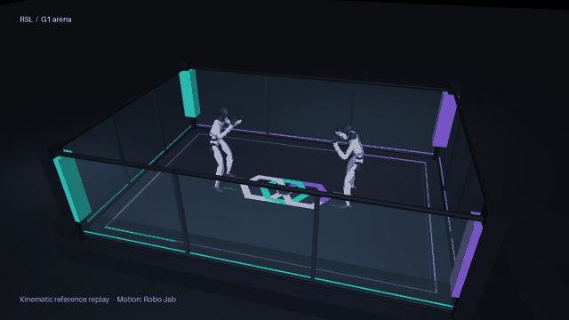
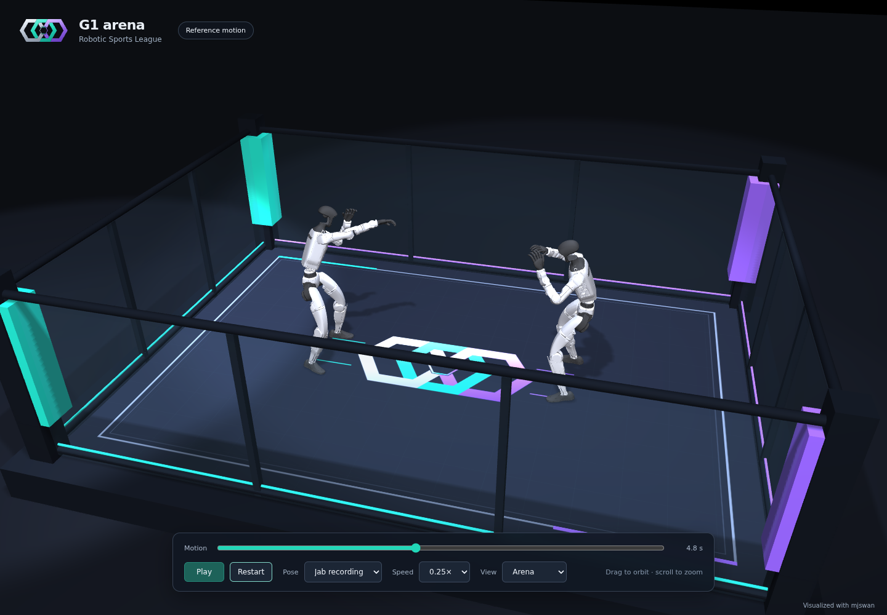

# G1 arena demo

[Main guide](README.md)

[](assets/g1-arena.mp4)

[Watch the 1080p video](assets/g1-arena.mp4). Two standard 29 DoF Unitree G1s start in a nominal pose, enter guard, take turns punching the air and return to nominal. The rectangular arena has a centered RSL mark, clear wall panels and turquoise and violet corner pads.

This is **kinematic reference playback** of retargeted Robo Jab data. It is useful for inspecting the arena, pose mapping, timing and proposed skills. It does not run SONIC, a learned tracker or a balance controller. The physics model has working robot, floor and enclosure contacts, but those contacts do not govern the preview poses.

## Run the browser demo

Install [uv](https://docs.astral.sh/uv/getting-started/installation/) and use Python 3.11 or newer. From the repository root:

```bash
uv sync --project simulation --locked
uv run --project simulation python simulation/demo.py
```

The first run downloads one checksum-verified motion CSV, installs mjswan's isolated Node environment and builds its browser engine. It opens `http://localhost:8765`. A WebGL2-capable browser is required; the viewer does not require an NVIDIA GPU. If that port is occupied, add `--port 18765`.

Drag to orbit and scroll to zoom. The controls provide pause, restart, a timeline, playback speed, nominal pose and three camera positions. Speed changes the reference clock: `0.5×` plays a motion over twice its original duration. It does not change an actuator action scale.

The scene is packaged locally. Later launches can reuse it without rebuilding or downloading:

```bash
uv run --project simulation python simulation/demo.py --serve-existing
```

To package the demo without starting a server:

```bash
uv run --project simulation python simulation/demo.py --build-only
```

The output is `simulation/output/web/`. Serve that directory over HTTP; opening `index.html` as a local file will not load its WebAssembly and scene assets. The directory includes mjswan's license, notice and bundled dependency credits under `engine/`.



## Use the Python viewer or render a video

A local desktop with OpenGL can use MuJoCo's native viewer:

```bash
uv run --project simulation python simulation/demo.py --viewer native
uv run --project simulation python simulation/demo.py --viewer native --mode nominal
```

On macOS, launch the native viewer with MuJoCo's `mjpython` from the simulation environment. The browser viewer avoids that platform-specific requirement.

The repository video is generated by this command on Linux with EGL:

```bash
MUJOCO_GL=egl uv run --project simulation python simulation/demo.py \
  --render docs/assets/g1-arena.mp4 \
  --poster docs/assets/g1-arena.jpg \
  --gif docs/assets/g1-arena.gif
```

It produces 10.83 seconds of H.264 video at 1920 × 1080 and 30 fps, plus a small animated excerpt. FFmpeg comes from the Python environment. An EGL driver is needed for this headless rendering path. Use the platform's normal OpenGL setup for desktop rendering. `--speed`, `--duration`, `--fps`, `--width` and `--height` adjust the export.

## Scene and motion

| Component | Implementation |
| --- | --- |
| Mat | 4.6 × 3.2 m rectangle, top surface at world z = 0 |
| Enclosure | Fixed box panels, capsule rails and padded corner boxes; no deformable ropes |
| Robots | Two free-root G1s with 29 joints and 29 torque actuators each |
| Contacts | 97 box, capsule, sphere and plane colliders; visual meshes and lighting strips do not collide |
| Spawn | Root x = −1.05 m and +1.05 m, facing inward |
| Reference | Robo Jab `IMG_3430.csv`, original frames 85 through 289 at 30 fps |
| Motion changes | Constant heading alignment, root translation to each spawn, per-frame floor alignment, one-second blends to and from nominal, 0.7-second delay for the second robot |
| Viewer | The local mjswan engine, with a small `setPose` API for paused scenes without a policy |

The CSV has root position, an **xyzw** quaternion and 29 joint angles. The loader checks its pinned Git blob hash, shape and quaternion normalization, converts rotations to MuJoCo's **wxyz** order and maps joints by name. Translation and joint interpolation are linear; quaternion interpolation follows the shortest spherical path. The original recording stays unchanged in the ignored download cache. [Source and provenance](assets/README.md#g1-arena-preview)

The floor mark uses the intact paths from the supplied SVG. The original pasted data ended inside its final center detail, so that incomplete detail is omitted and recorded in the asset description. Replace it with a complete SVG without editing the scene code:

```bash
uv run --project simulation python simulation/demo.py --logo /path/to/complete-rsl.svg
```

The G1 visuals, inertias and primitive envelopes come from the included Unitree model. Self contacts are enabled except for adjoining wrist and hip assemblies whose simplified shapes overlap. Robot-to-robot and robot-to-enclosure contacts remain enabled. The transparent panels are rigid physics walls; transparency is visual only.

## Extend it into a controlled simulation

[`simulation/arena.py`](../simulation/arena.py) exposes a small physics interface:

```python
# From a script in simulation/, using the simulation environment.
import numpy as np
from arena import Arena

arena = Arena()
qpos = arena.reset()
qpos = arena.step(np.zeros((2, 29)))
```

`step` accepts motor torques in Nm, clips them to the configured effort limits and advances one 2 ms physics step. Zero torque lets the robots fall. `reset` sets a nominal posture; it does not establish feedback balance. Motor speed, thermal limits and drivetrain dynamics are not modeled by these simple torque actuators.

A controller integration should replace the replay pose writes with observations and torque commands from the actual controller contract. If a policy produces joint targets, implement its matching gains, action scale and control interval. Reproduce standing and single-robot tracking first, then add targets, missed strikes, blocked strikes and disturbances. The enclosure is available for those experiments; it is not yet an mjlab training task or a fight scoring system. See [training](training.md) and [deployment](deployment.md).

## Verification

```bash
uv run --project simulation pytest simulation/tests -q
uv run --project simulation python simulation/demo.py --check
```

The tests check joint ordering, absence of mesh colliders, robot and floor contacts, torque clipping, invalid input and quaternion interpolation. The check replays every frame, rejects robot-to-robot contact in the air-punch demo and runs 1,000 physics steps. The current excerpt has a minimum root separation of 1.889 m and no measured penetration beyond floating-point tolerance after adjacent-link exclusions and floor alignment.

For the browser acceptance check, leave the demo server running in another terminal:

```bash
uv run --project simulation playwright install chromium
uv run --project simulation python simulation/check_browser.py
# Or add --url http://localhost:18765 if using that port.
```

This checks actual WebGL rendering, pose changes, pause, play, reset, nominal selection, camera controls, invalid poses and mobile layout. It writes `simulation/output/mjswan.png`. The local mjswan pose validator also has two passing Vitest tests, and the frontend build includes TypeScript checking. The video and browser screenshots were visually reviewed on 6 November 2026.
